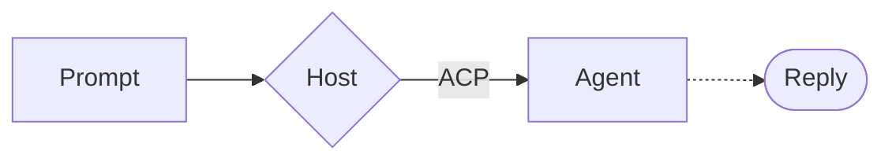
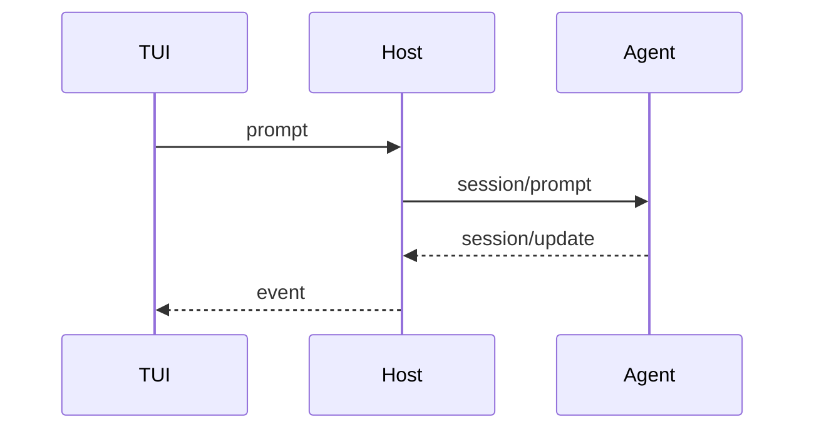
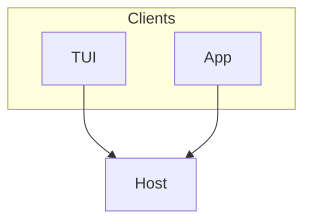

Here is the rich Markdown agents write.

## Diagrams

A flowchart:



A sequence diagram:



One with a subgraph, which not every renderer draws:



And one that doesn't parse:

```mermaid
flowchart LR
    A[Unclosed --> B
```

## Math

Inline in dollars, $e^{i\pi} + 1 = 0$, and in parentheses, \(a^2 + b^2 = c^2\).

$$
x = \frac{-b \pm \sqrt{b^2 - 4ac}}{2a}
$$

\[
\sum_{k=1}^{n} k = \frac{n(n+1)}{2}
\]

```math
\int_0^1 x^2 \, dx = \frac{1}{3}
```

A matrix, $$\begin{pmatrix} a & b \\ c & d \end{pmatrix}$$, and an unknown command, $\notacommand{x}$.

Not math: it costs $5 and $10, and $HOME is your home directory.

## Alerts

> [!NOTE]
> Threads outlive the TUI.

> [!TIP]
> `weave --resume` finds the thread again.

> [!IMPORTANT]
> The Host runs the agents.

> [!WARNING]
> Quitting the Host ends its threads' turns.

> [!CAUTION]
> Agent text is untrusted.

## The rest

A claim with a footnote.[^1]


| Keys | What they do |
| --- | --- |
| <kbd>Ctrl</kbd>+<kbd>T</kbd> | Detailed view<br>of tool calls |
| <kbd>Esc</kbd> | Takes back a queued message |

<details>
<summary>More</summary>

Hidden **Markdown** inside.

</details>

```rust
fn main() {
    println!("hello");
}
```

```ts
const answer: number = 42;
```

[^1]: The footnote's text.
